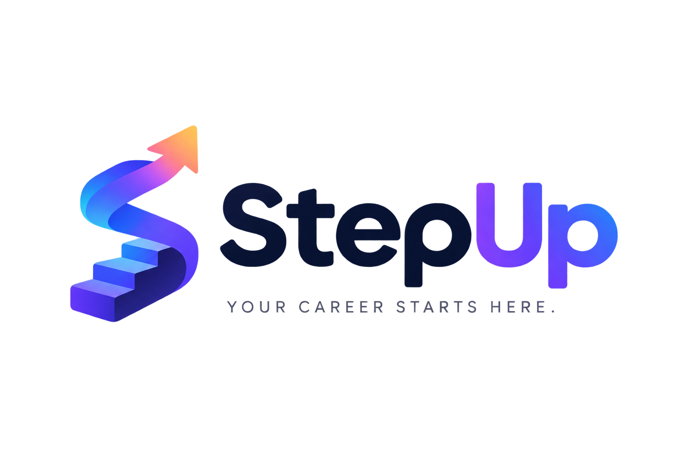

<div align="center">
  
  <h1>🚀 StepUp: AI Career Intelligence Platform</h1>
  <p><i>Your Career Starts Here.</i></p>
</div>

> **Transforming resume analysis from simple keyword matching to actionable, AI-driven career roadmaps.**

[](https://www.python.org/)
[](https://fastapi.tiangolo.com/)
[](https://developer.mozilla.org/en-US/docs/Web/HTML)
[](#-testing)

---

## 🌟 Overview

Traditional resume scanners rely on basic keyword counting, which encourages "keyword stuffing" and fails to understand context.

**StepUp** is an AI Career Intelligence Platform that uses a **3-Model Machine Learning Pipeline** to analyze resume-to-job fit and generate personalized **"Proof-to-Job" Project Blueprints**. It doesn't just tell candidates what they're missing; it gives them a roadmap to learn it and prove it to recruiters.

---

## ✨ Key Features

- 🔒 **Resume Validation ("Authentication")**: Every upload is checked before it is processed: real file type (by magic bytes, not extension), a 5 MB streaming size limit, readable text (rejects scanned, encrypted or corrupted PDFs), and a resume-likeness check. A green badge shows the confidence score.
- 📄 **Smart Document Parsing**: Extracts and cleans text from PDF, DOCX and TXT resumes, or accepts pasted text.
- 🧠 **ML Model 1, NER and Skill Extraction**: `spaCy` extracts companies and dates, and a vocabulary of 70+ skills (with aliases like `k8s`, `Node.js`, `sklearn`) is matched as whole words, so "Java" never matches inside "JavaScript".
- 🔗 **ML Model 2, Semantic Skill Matching**: Your **Required Skills** list is the source of truth. Each skill is decided by exact/alias match, then group logic (AWS satisfies Cloud), then a mention in the resume text, and finally `Sentence-Transformers` (all-MiniLM-L6-v2) cosine similarity as a fallback. Works for any field (web, data science, DevOps and more).
- 📊 **Transparent ATS Score**: 70% required-skill coverage + 30% contextual semantic alignment, shown as a score ring plus a 5-axis radar chart (Technical Skills, Experience, Education, Soft Skills, Domain Knowledge) computed from the actual resume.
- 🤖 **ML Model 3, Generative AI Blueprint**: `Google Gemini` designs a portfolio project plan targeting your missing skills, with a tech stack and an ATS-friendly resume bullet (metrics are placeholders like `[X]%`, never invented numbers).
- 🎙️ **AI Mock Interviews**: Three role-specific questions with hints, based on your skill gaps.
- 🛡️ **Graceful Degradation**: If Gemini is unavailable (quota or network), the score, skill gaps and charts still appear, and the blueprint card shows a Retry button.
- 🎨 **Zero-Build Frontend**: A responsive, dual-theme (Light/Dark) dashboard in pure HTML5, Vanilla JavaScript, Tailwind CSS (CDN) and Chart.js. All AI text is HTML-escaped.

---

## 🏗️ Tech Stack

| Category             | Technologies                                      |
| :------------------- | :------------------------------------------------ |
| **Backend**          | Python, FastAPI, Uvicorn, Pydantic                |
| **Machine Learning** | spaCy, Sentence-Transformers, Scikit-Learn        |
| **Generative AI**    | Google Gemini API (`google-genai`)                |
| **Frontend**         | HTML5, Vanilla JavaScript, Tailwind CSS, Chart.js |
| **Utilities**        | `pdfplumber`, `python-docx`, `python-dotenv`      |
| **Testing**          | `pytest`, Playwright (Chromium)                   |

---

## ⚙️ How It Works (The Pipeline)

1. **Upload and validate**: The user uploads a resume (or pastes text). The backend validates it and extracts clean text.
2. **Extract**: `spaCy` and the skill vocabulary identify the skills found in the resume.
3. **Match**: Each required skill is matched against the resume, producing matched/missing lists, an ATS score and the radar breakdown. Results render immediately.
4. **Generate**: `Gemini` takes the missing skills, matched skills, target role and job description to produce the project blueprint, and, on demand, the mock interview questions.

---

## 🚀 Installation & Local Setup

### Prerequisites

- Python 3.10+
- A [Google Gemini API Key](https://aistudio.google.com/app/apikey)
- A modern web browser (Chrome, Firefox, Edge)
- Internet access (Tailwind, Chart.js and fonts load from CDNs)

### 1. Backend Setup

```bash
cd backend

# Create and activate a virtual environment
python -m venv venv
source venv/bin/activate  # On Windows: venv\Scripts\activate

# Install dependencies
pip install -r requirements.txt

# Download the spaCy English model
python -m spacy download en_core_web_sm

# Create a .env file with your API key (never commit this file)
echo "GEMINI_API_KEY=your_actual_api_key_here" > .env

# Run the FastAPI server (http://127.0.0.1:8000)
uvicorn main:app --reload
```

Optional `.env` setting: `GEMINI_MODEL=models/gemini-2.5-flash` (the default). Change it to use another Gemini model.

### 2. Frontend Setup

No build tools or npm required. With the backend running, open `index.html` from the project root in your browser (or use a local server such as the VS Code Live Server extension).

---

## 🔒 Resume Validation Rules

- **File size**: Max 5 MB, read in chunks so oversized files are rejected without loading into memory
- **File type**: PDF, DOCX or TXT, detected from the file's actual bytes (a renamed `.exe` is rejected)
- **Text extraction**: Rejects scanned/image-only, password-protected (with a specific message) and corrupted files
- **Content check**: At least 150 characters, 2+ resume sections (Education, Experience, Skills and so on) and an email or phone number
- **Pasted text**: Same content checks apply

---

## 🔌 API Endpoints

| Method | Endpoint                  | Purpose                                    |
| :----- | :------------------------ | :----------------------------------------- |
| GET    | `/health`                 | Health check                               |
| POST   | `/api/upload-resume`      | Validate a file and extract its text       |
| POST   | `/api/validate-text`      | Validate pasted resume text                |
| POST   | `/api/extract-entities`   | spaCy entities and resume skills           |
| POST   | `/api/match-skills`       | Skill matching, ATS score, radar breakdown |
| POST   | `/api/generate-blueprint` | Gemini project blueprint                   |
| POST   | `/api/generate-interview` | Gemini mock interview questions            |

Validation errors return HTTP 200 with `{"status": "error", "message": "..."}`.

---

## 🧪 Testing

26 automated tests (+1 optional live test): resume validation, skill matching across different roles, and browser tests (upload, drag-and-drop, error states, full analysis flow, graceful degradation). Gemini is mocked in the browser tests, so they pass without API quota.

```bash
# Install test dependencies (once)
pip install pytest pytest-playwright
playwright install chromium

# Start the backend in one terminal, then in another, from the project root:
./backend/venv/bin/pytest backend/evaluation -v -m "not live"

# Optional: one test that calls the real Gemini API (uses quota)
./backend/venv/bin/pytest backend/evaluation -v -m live
```

Sample resumes used by the tests are in `test_files/`. Test screenshots are saved to `backend/evaluation/screenshots/`.

---

## 📁 Project Structure

```
StepUp/
├── index.html              # Single-file frontend
├── logo.png
├── test_files/             # Sample resumes used by the tests
└── backend/
    ├── main.py             # FastAPI app and ML pipeline
    ├── skills.py           # Skill vocabulary, aliases, groups
    ├── resume_validator.py # Resume file/text validation
    ├── requirements.txt
    └── evaluation/         # Tests and report scripts (accuracy, similarity, latency)
```

---

## ⚠️ Known Limitations

- The Gemini free tier is limited (about 20 requests per day), so the blueprint and interview features can hit quota. Results are cached, and the UI shows a Retry option.
- The skill vocabulary covers common tech skills; skills outside it are matched by resume-text mention or semantic similarity.
- The frontend expects the backend at `http://127.0.0.1:8000`.

---

## 📚 Academic & Research Alignment

This project architecture is inspired by recent advancements in AI-driven recruitment:

- **SMART-HIRING Framework**: Uses NER for structural parsing and semantic embeddings for contextual matching.
- **H3S (Hybrid Semantic-Structural Skill) Model**: Supports transformer-based embeddings over traditional TF-IDF/BM25 keyword matching to reduce bias and false negatives in candidate screening.

---

## 🔮 Future Scope

- LinkedIn API integration for one-click profile import
- User authentication (JWT) and persistent dashboard history
- Multi-language resume support using multilingual transformer models
- Verification signals (GitHub link checks, date consistency)

---

## 👨‍💻 Author

**nikethanp17**

Built with ❤️ for the future of fair, actionable and intelligent career development.
