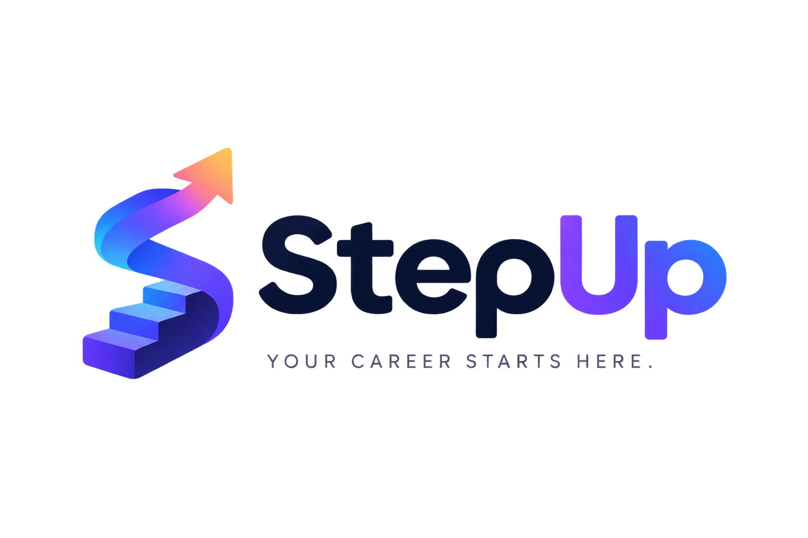

<div align="center">
  
  <h1> StepUp: AI Career Intelligence Platform</h1>
  <p><i>Your Career Starts Here.</i></p>
</div>

> **Transforming resume analysis from simple keyword matching to actionable, AI-driven career roadmaps.**

[](https://www.python.org/)
[](https://fastapi.tiangolo.com/)
[](https://react.dev/)
[](LICENSE)

---

## 🌟 Overview

Traditional resume scanners (like Jobscan or ResumeGuru) rely on basic keyword counting, which encourages "keyword stuffing" and fails to understand context.

**StepUp** is a next-generation AI Career Intelligence Platform that uses a **3-Model Machine Learning Pipeline** to not only analyze resume-to-job-description fit but also generate personalized, actionable **"Proof-to-Job" Project Blueprints**. It doesn't just tell candidates what they're missing; it gives them the exact roadmap to learn it and prove it to recruiters.

---

## ✨ Key Features

- 📄 **Smart Document Parsing**: Automatically extracts text from PDF, DOCX, and TXT resumes.
- 🧠 **ML Model 1: Named Entity Recognition (NER)**: Uses `spaCy` to intelligently extract companies, dates, and technical skills while anonymizing PII.
- 🔗 **ML Model 2: Semantic Skill Matching**: Uses `Sentence-Transformers` (all-MiniLM-L6-v2) to calculate cosine similarity, understanding that "JS" and "JavaScript" are a match, drastically reducing false negatives.
- 🤖 **ML Model 3: Generative AI Blueprint**: Leverages `Google Gemini` to generate a customized weekend project, tech stack, and ATS-friendly resume bullet points to bridge identified skill gaps.
- 🎨 **Modern UI/UX**: A sleek, responsive, dark-mode dashboard built with React, Vite, and Tailwind CSS.

---

## 🏗️ Tech Stack

| Category             | Technologies                               |
| :------------------- | :----------------------------------------- |
| **Backend**          | Python, FastAPI, Uvicorn, Pydantic         |
| **Machine Learning** | spaCy, Sentence-Transformers, Scikit-Learn |
| **Generative AI**    | Google Gemini API (`google-genai`)         |
| **Frontend**         | React 18, Vite, Tailwind CSS               |
| **Utilities**        | `pypdf`, `python-docx`, `python-dotenv`    |

---

## ⚙️ How It Works (The Pipeline)

1. **Upload**: User uploads a resume (PDF/DOCX/TXT) and pastes a target Job Description.
2. **Extract**: Backend parses the document and uses `spaCy` to identify existing skills.
3. **Match**: `Sentence-Transformers` compares the resume skills against the JD requirements semantically, calculating a fit score and identifying true skill gaps.
4. **Generate**: `Gemini AI` takes the missing skills and target role to generate a structured, actionable project blueprint.

---

## 🚀 Installation & Local Setup

### Prerequisites

- Python 3.10+
- Node.js 18+
- A valid [Google Gemini API Key](https://makersuite.google.com/app/apikey)

### 1. Backend Setup

```bash
cd backend
python -m venv venv
source venv/bin/activate  # On Windows: venv\Scripts\activate
pip install -r requirements.txt

# Download spaCy model
python -m spacy download en_core_web_sm

# Create .env file and add your API key
echo "GEMINI_API_KEY=your_actual_api_key_here" > .env

# Run the server
uvicorn main:app --reload
```

### 2. Frontend Setup

```bash
cd frontend
npm install
npm run dev
```

📚 Academic & Research Alignment

This project architecture is directly inspired by recent advancements in AI-driven recruitment:
SMART-HIRING Framework: Utilizes NER for structural parsing and semantic embeddings for contextual matching.
H3S (Hybrid Semantic-Structural Skill) Model: Validates the use of transformer-based embeddings over traditional TF-IDF/BM25 keyword matching to reduce bias and false negatives in candidate screening.

🔮 Future Scope

Integration with LinkedIn API for one-click profile importing.
Real-time mock interview generation based on identified skill gaps.
Multi-language resume support using multilingual transformer models.

👨‍💻 Author
Nikky

Built with ❤️ for the future of fair, actionable, and intelligent career development.
